# Your Mindmap

**在 Obsidian 里画思维导图。** 支持桌面端与移动端，导图以普通 `.md` 笔记的形式保存在你自己的仓库里（旧版 `.smm.md` 文件同样兼容），
也可以用 `smm` 代码块直接嵌入普通笔记。

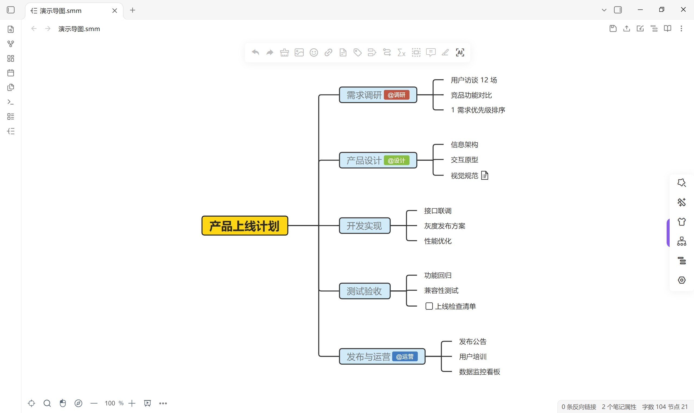

---

## 特色

|  |  |
|---|---|
| **结构** | 逻辑结构图、思维导图、组织结构图、目录组织图、**时间轴**（5 种）、**鱼骨图**（4 种）、**表格** |
| **主题** | 经典 / 深色 / 朴素 / **彩虹** 四组，40+ 套配色，一键切换 |
| **节点** | 富文本、图片、图标、标签、备注、超链接、附件、公式、概要、外框、关联线 |
| **进阶能力** | **手绘风格**、**画布动量**、**连线流动**、**节点标注**、**逐行编号**、**一键编号**、**待办勾选**、**隐藏文本**、**13 种专属形状** |
| **导入** | `.smm` / `.json` / `.md` / `.txt` / `.opml` / `.mm` / `.xlsx` / XMind，支持粘贴 Markdown、Txt 内容导入 |
| **导出** | `.smm` / `.json` / Markdown / Txt / **HTML** / **Excel** / **FreeMind** / **Mermaid** / **OPML** / PNG / JPG / SVG / **PDF**（内嵌超链接可点击） |
| **Obsidian 集成** | `smm` 代码块嵌入编辑、新标签页预览为思维导图、双向链接、命令面板命令 |
| **演示** | 演示模式、**填空模式**、**进入指定节点**、大纲模式、只读模式、禅模式 |

### 结构与主题

点击右侧面板即可切换 7 类结构、4 组主题；切换只改样式，不改内容。

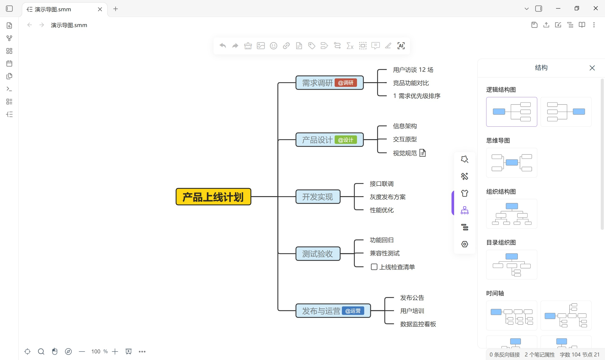
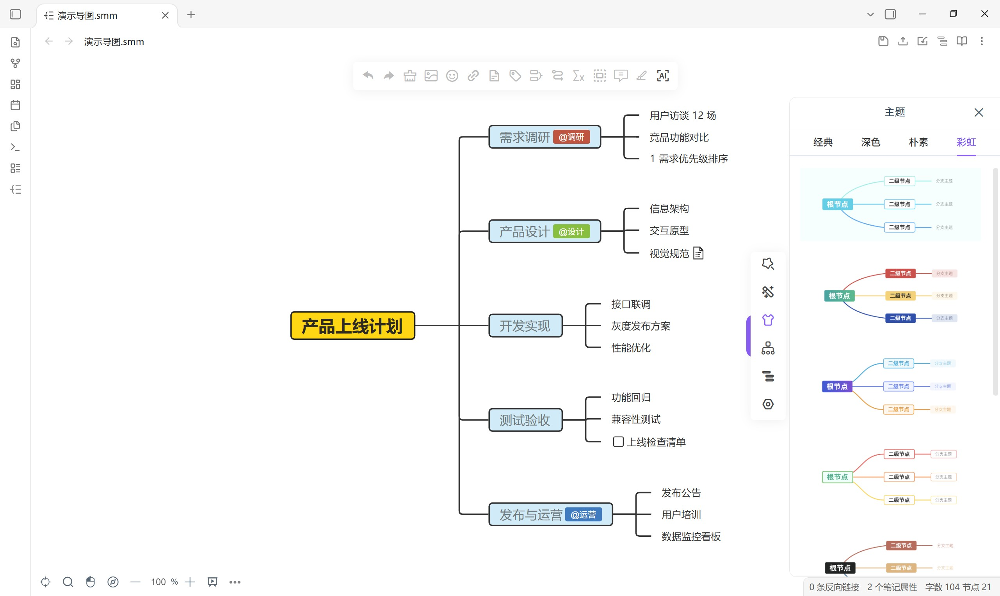

### 节点样式

文字、边框、形状、线条、外框、标注逐项可调；支持多选批量修改。
线条可开启**流动效果**，形状里包含心形、五角星、云朵、爆炸、水滴、火焰等 13 种专属形状。

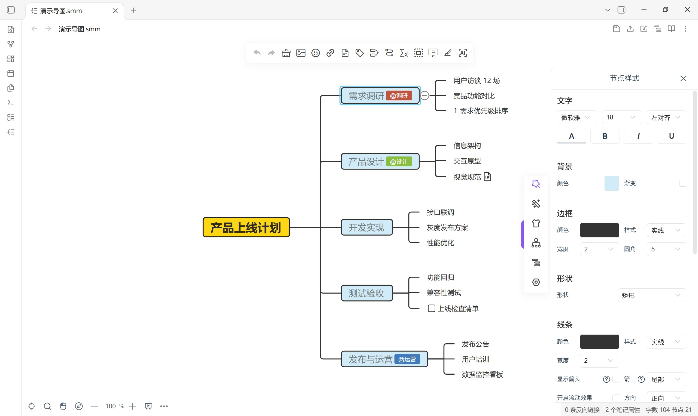

### 导入 / 导出

导入支持 8 种格式，导出支持 13 种格式（含 Excel、Mermaid、OPML、PDF）。

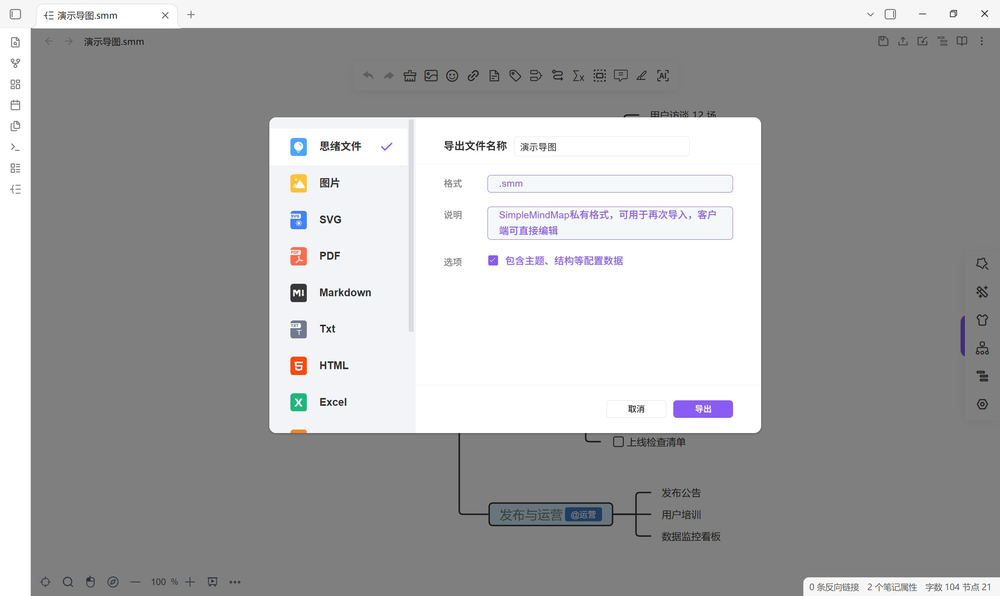
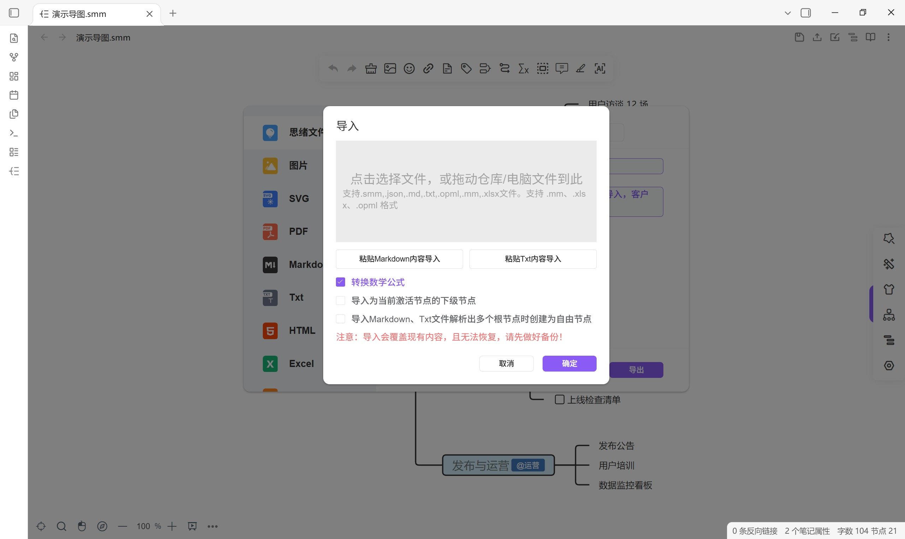

### 嵌入到笔记里

在任意 Markdown 笔记中写 `smm` 代码块，就能把思维导图嵌进正文，直接在文档里拖拽编辑：

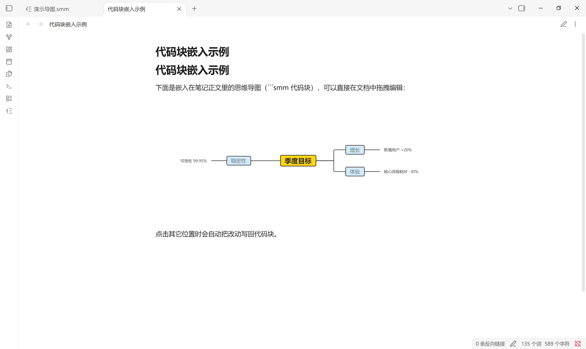

### 演示模式

底部工具栏的播放按钮进入全屏演示，配合**填空模式**做讲解或复习。


### 鱼骨图 / 时间轴

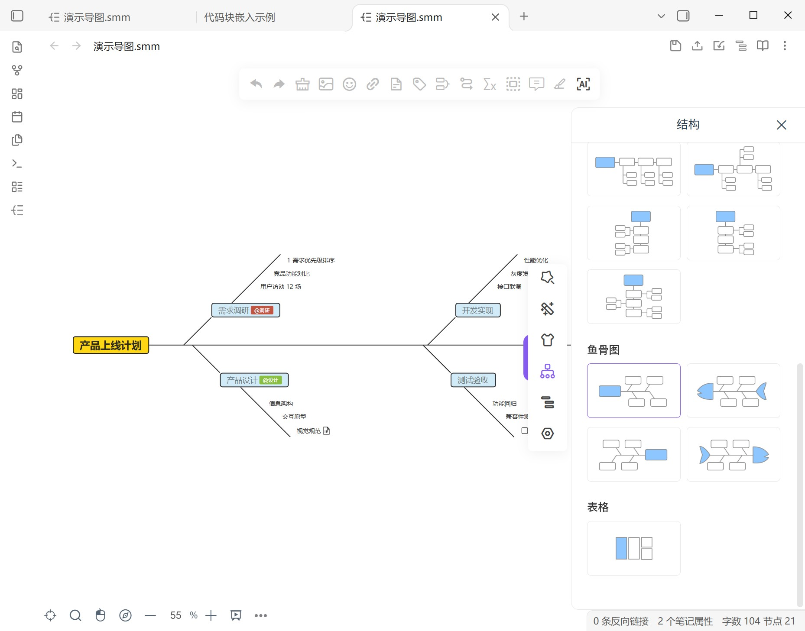
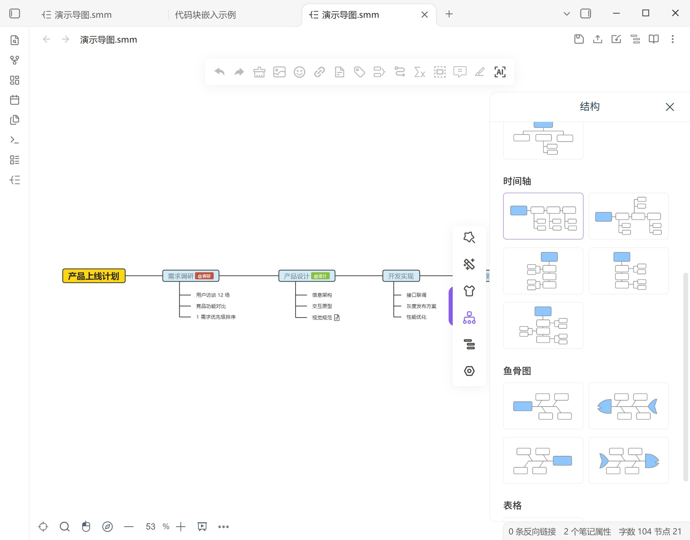

---

## 动态演示

**切换结构**：逻辑结构图 → 鱼骨图 → 时间轴 → 表格 → 思维导图

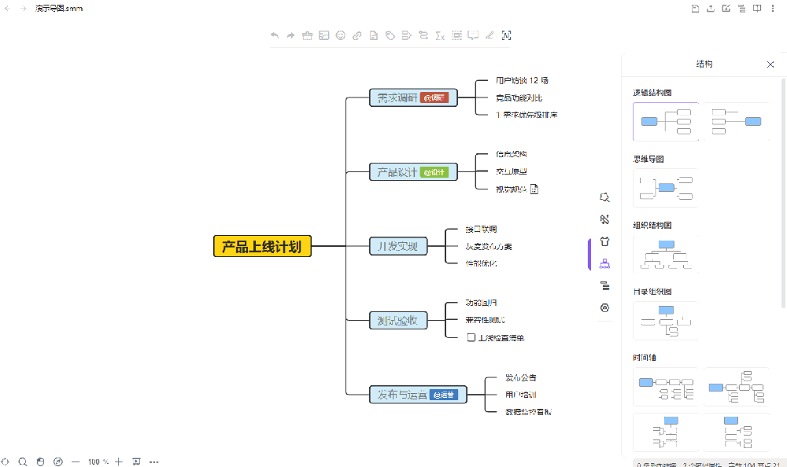

**切换主题**：经典 → 深色 → 彩虹

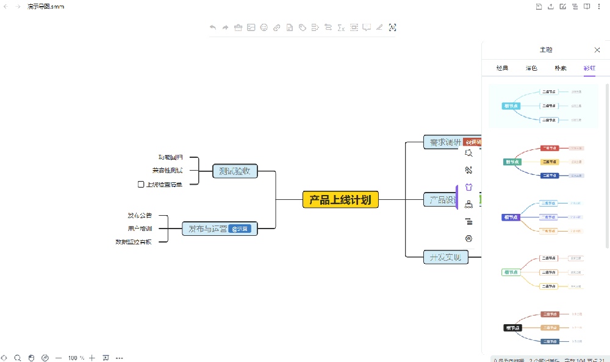

---

## 安装

插件目录结构：

```text
<你的仓库>/.obsidian/plugins/your-mindmap/
├── main.js
├── manifest.json
└── styles.css
```

1. 本页右上角 **Code → Download ZIP**（或下载 [Releases](../../releases) 里的压缩包，或 `git clone`）
2. 把 `main.js`、`manifest.json`、`styles.css` 三个文件放进
   `<你的仓库>/.obsidian/plugins/your-mindmap/`（文件夹名必须是 `your-mindmap`）
3. 打开 Obsidian → **设置 → 第三方插件** → 关闭"受限模式"（首次安装时）
   → 点 **重新加载插件**（或按 `Ctrl/Cmd + R`）→ 启用 **Your Mindmap**
4. 点左侧功能区图标，或右键文件夹 → 新建思维导图，即可开始

完整步骤（各系统路径、移动端、更新、卸载、回滚、常见问题）见
**[docs/安装说明.md](docs/安装说明.md)**。

用 `git clone` 安装：

```bash
cd "<你的仓库>/.obsidian/plugins"
git clone https://github.com/358866/your-mindmap.git your-mindmap
```

---

## 文档

| 文档 | 内容 |
|------|------|
| [安装说明](docs/安装说明.md) | 手动安装、移动端安装、启用、更新、卸载、回滚、常见问题 |
| [使用说明](docs/使用说明.md) | 完整操作手册：从第一张导图到全部高级功能 |
| [功能清单](docs/功能清单.md) | 全部功能与入口位置速查 |
| [更新日志](CHANGELOG.md) | 版本变更记录 |

## 设置页一览

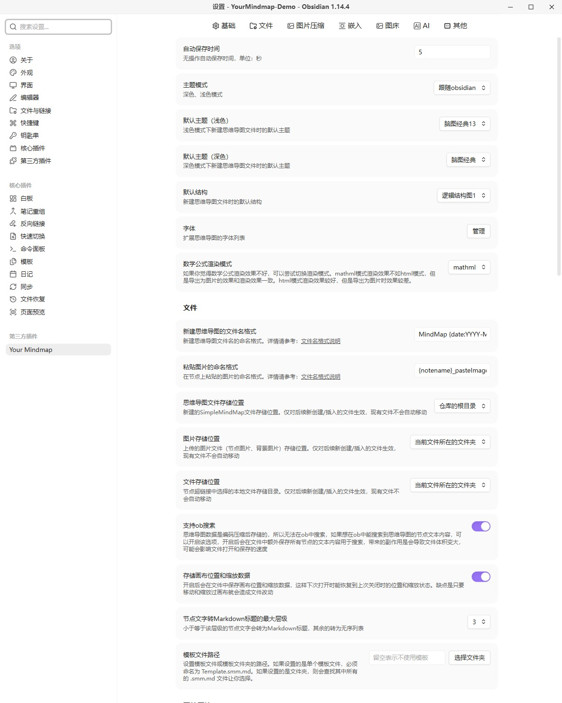
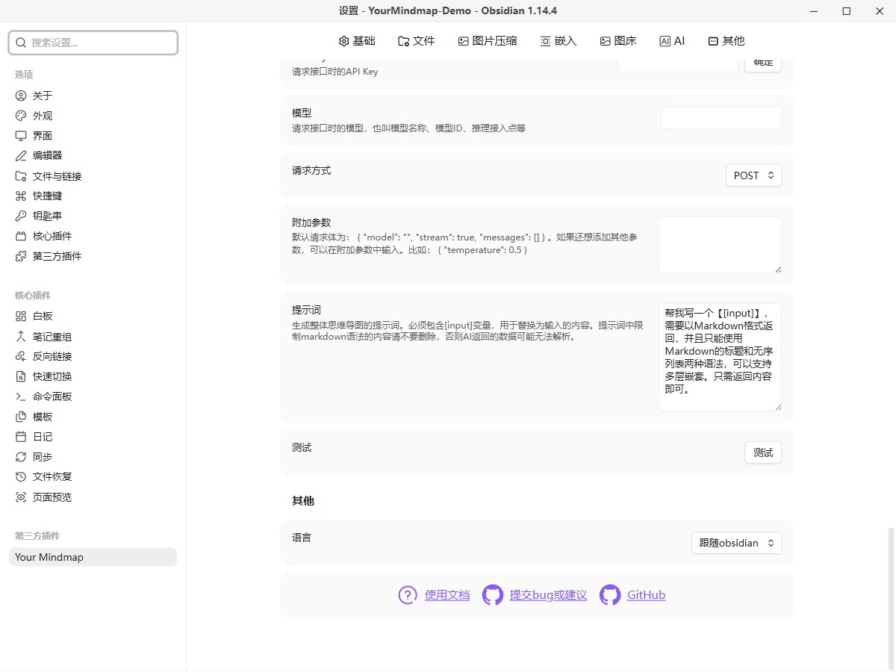

## 兼容性

- Obsidian **1.8.3** 及以上
- Windows / macOS / Linux / iOS / Android
- 只使用 Obsidian 官方 API，不改动仓库里的其它文件

## 已知限制

- `smm` 代码块语言同一时间只能被一个插件占用。如果同时安装并启用了其它注册 `smm`
  的插件（例如 ob-smm），内联代码块会被对方接管；此时停用其中一个插件并重新加载
  Obsidian 即可。
- 大图建议在设置中开启**性能模式**。

## 致谢

本插件基于原作者开源的思维导图项目构建，感谢原作者的开源与分享。
